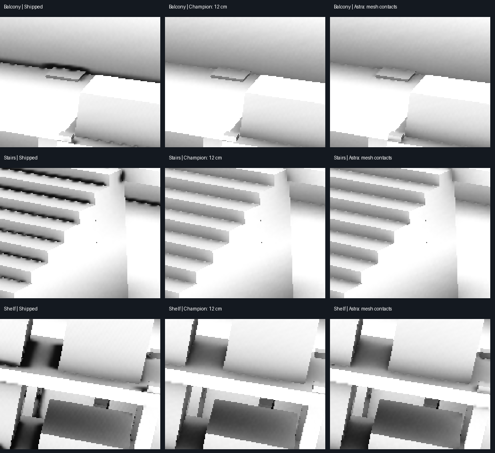

# Mesh contact repair: Apple M1 GPU validation

Validated 2026-11-17. Implemented by GPT-6 Astra medium after the owner authorized a broader renderer fix beyond run 2’s estimator-only contract. This is a GPU-validated renderer successor, not a champion certified by that unchanged CPU judge.

## Change

The 12 cm ray start removed coarse-field self-shadowing but skipped real blockers. Each sampled direction now first checks static mesh triangles over the near segment (12 cm + half a field voxel diagonal, 24.74 cm here), with a 0.3 mm normal offset. A conservative 1 m grid selects a local BVH; exact triangle intersections preserve thin blockers without the volume’s self-surface bias. The champion’s far-field trace, 4/3/2 early direction schedule and blend denominator +3 remain. Geometry is extracted from mesh vertex/index/instance transforms, with no scene IDs or reference-data access.

## Actual production renderer

Chrome WebGL2 / ANGLE Metal on Apple M1, 1280×720 output, 640×360 AO, six views, 512-ray references. Production `index.html` was loaded and scored independently of the injected prototype. Tiny shader-evaluation differences from the prototype affect a few samples (maximum 2/255); aggregate results agree.

| Frames | Fitting shipped | Fitting champion 2 | Fitting repair | Held-out shipped | Held-out champion 2 | Held-out repair |
|---|---:|---:|---:|---:|---:|---:|
| 1 | 0.027135 | 0.024129 | 0.023891 | 0.024661 | 0.022411 | 0.022095 |
| 4 | 0.023830 | 0.017482 | 0.016837 | 0.021211 | 0.016389 | 0.015505 |
| 16 | 0.019276 | 0.010381 | 0.009131 | 0.017155 | 0.009990 | 0.008360 |
| 64 | 0.017354 | 0.008630 | 0.007457 | 0.015442 | 0.008137 | 0.006509 |

At16 frames the repair reduces error a further12.0% fitting /16.3% held out versus champion2, or52.6% /51.3% versus shipped main. All24 view/frame comparisons improve over champion2.

## Contact validation and limits

Across16,459 contact samples within5cm of another object, mean positive visibility error (too little shadow) falls from0.024801 to0.008373 at16 frames and from0.023430 to0.005557 at64. Both beat shipped main (0.018653 /0.015503). Contact MAE also improves:0.037279→0.025794 at16,0.037770→0.026539 at64.

Controlled plate test: same GPU estimator and generic triangle accelerator, with an independent16,384-ray CPU box-intersection reference. For2/4/8/12cm gaps, center visibility becomes0.00614/0.02215/0.07954/0.16695 versus reference0.00513/0.02039/0.07697/0.15778. Champion2 produced0.85794/0.70721/0.34498/0.44098. This confirms recovery of the skipped near blockers.

**Residuals remain.** Exact mesh coverage ends at24.74cm; the farther field is still approximate. The diagnostic balcony sample improves0.69412→0.54510, but its reference is0.40234. At20cm plate gap, center visibility is0.39331 versus0.34106. This is not a zero-pixel-regression result:652 contact samples at16 and844 at64 remain more than4/255 worse in absolute error than shipped main, despite substantially lower pooled contact error. The strict zero-regression diagnostic therefore does not pass; this repair addresses geometric skipping while preserving aggregate accuracy, rather than guaranteeing improvement at every pixel.

## Motion, cost, and controls

All three orbit speeds (1/3/10degrees per frame ending at the main view) improve over champion2:0.011241/0.012295/0.016309 versus0.011931/0.012917/0.016592. Four frozen held-out mover poses improve both whole-view and mover-near error. This does not establish continuous moving-object temporal quality; the existing dynamic AO path is unchanged.

| Variant | Early frame median | Orbit frame median |
|---|---:|---:|
| seed | 1.319ms | 1.234ms |
| champion | 1.472ms | 1.206ms |
| next | 3.247ms | 2.056ms |

These are12 interleaved readback-synchronized render wall-time batches, not pure GPU timestamps. The fix costs ~1.78ms early /0.85ms orbiting above champion2. Global BVH prototype cost~12ms early; the local grid retains quality at3.25ms. Additional textures occupy1,463,424bytes (~1.40MiB), built once in~200–260ms. Instrumented main-view frame0/16 averages~68.5/34.3 geometry texture fetches per AO pixel, plus~20.3/13.1 SDF reads. The former14.25-read contract does not cover this renderer.

All seven AO modes render with no GL errors after clearing a startup warning state. Static-resource rebuild replaces textures and resets history. No shader compilation errors. Static mesh edits require rebuilding both this contact resource and the baked distance field; moving meshes remain on the existing dynamic path.

## Reproduction

- `python3 benchmark/build-traced-validation.py` builds the fixed shipped baseline page and aligned reference mappings; it expects sibling `thermite-kit-traced-ao` reference files.
- `python3 benchmark/serve-traced-validation.py` serves the repository at127.0.0.1:8918 and saves artifacts under `output/playwright/traced-run2/`.
- In the baseline page, load `benchmark/install-traced-candidate.js`, then `benchmark/install-traced-contact-bvh.js`; call `installContactBVHCandidate({tag:"astra-contact-grid1",gridSize:1})` and `gpuValidation.runView(name)` for all six views.
- Motion: `runMotionValidation({variants:["seed","champion","next"]})` after loading `benchmark/traced-motion-validation.js`. Thin-plate and fetch probes are in `traced-contact-bvh-probe.js` and `traced-contact-bvh-reads.js`.
- Load actual `/index.html`, then `benchmark/validate-contact-production.js`, and call `validateContactProduction()` to score the unmodified production shader against saved prototype pixels.
- Compact checked-in evidence: [contact-results.json](contact-results.json). Full masks and crops remain in the local output directory.
